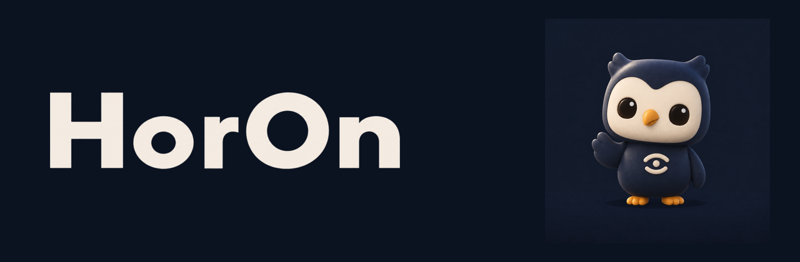

<p align="center">
  
</p>

# Horon AI

에이전트와 사람이 만나는 자리, AX(Agent Experience)를 만드는 조직입니다.

제품 이름은 **Horon**입니다. 모델을 호출해 도구를 실행하는 에이전트 엔진, 색·간격·글자 토큰과 컴포넌트 시스템, 그리고 사람이 쓰는 클라이언트 앱을 한 제품군으로 엮습니다.

<p align="center">
  
</p>

## 구성

| 구성 | 설명 | 저장소·문서 |
| --- | --- | --- |
| `agent` | Rust 에이전트 백엔드. 프로그램이 부르는 헤드리스 모드(`run`, `serve`, `api-bridge`, `acp`, `rpc`)와 터미널 UI(`horon-tui`)가 같은 데몬과 세션을 공유하며 OpenAI Chat Completions·Responses, Anthropic Messages, Gemini `generateContent` 엔드포인트를 직접 호출합니다. | [horon-ai/agent](https://github.com/horon-ai/agent) · [agent.horon.ai](https://agent.horon.ai) |
| `design` | 디자인 시스템. 색, 유리 표면, 글자, 반경, 그림자 토큰을 `@horon-ai/tokens` 한 곳에 두고 웹 컴포넌트(`@horon-ai/react`, Base UI + Tailwind CSS v4)와 앱 컴포넌트(`@horon-ai/expo`, Expo SDK 58)가 같은 값을 씁니다. | [horon-ai/design](https://github.com/horon-ai/design) · [design.horon.ai](https://design.horon.ai) |
| Horon 앱 | Expo + React Native 클라이언트(`ai.horon.app`). iOS·Android 앱과 정적 웹 화면을 한 코드로 구성하며 `@horon-ai/expo`와 `@horon-ai/tokens`, 자체 API(Hono + Bun + Postgres) 위에서 동작합니다. | 비공개(공개 준비 중) |

데이터를 읽고 답하는 데서 멈추지 않고 실행과 결과까지 이어 줍니다. 사람이 터미널에서 직접 다루든 다른 프로그램이나 에디터가 호출하든 같은 에이전트 데몬과 이벤트 로그 세션을 쓰고 화면은 하나의 디자인 토큰 위에서 같은 모양과 동작을 유지합니다.

## 시작하기

- 에이전트 문서: [agent.horon.ai](https://agent.horon.ai)
- 디자인 시스템 문서: [design.horon.ai](https://design.horon.ai)

```sh
# agent 설치 (macOS·Linux)
curl -fsSL https://raw.githubusercontent.com/horon-ai/agent/main/scripts/install/install.sh | bash
horon --version
```

```sh
# 디자인 패키지 설치 및 문서 사이트 로컬 실행 (http://localhost:4321)
bun add @horon-ai/react @horon-ai/tokens
git clone https://github.com/horon-ai/design && cd design && bun install && bun run site
```

## 이 조직

- 조직: [horon-ai](https://github.com/horon-ai)
- 제품: Horon
- 위치: 대한민국
