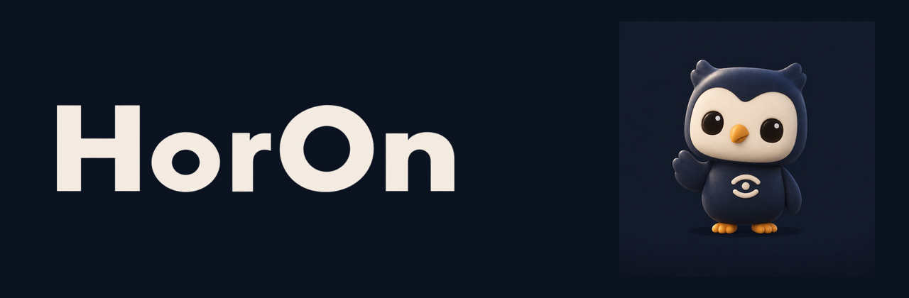

  

# Horon AI

에이전트가 사람과 맞닿는 자리, AX(Agent Experience)를 만드는 조직입니다.

제품 이름은 **Horon**입니다. 데스크톱·모바일·웹·서버를 한 제품으로 묶고, 에이전트 실행은 Hermes Agent에 붙입니다. 이 조직에는 그 제품과, 같은 경험을 다루는 주변 프로젝트를 올립니다.

데이터를 이해하는 데서 끝나지 않고, 실행과 결과까지 연결하는 쪽을 다룹니다.

  

## 무엇을 만드나

| 면 | 역할 |
|---|---|
| Desktop | Electron 데스크톱 클라이언트 |
| Mobile | iOS / Android 앱 (Expo) |
| Web | 랜딩과 웹 클라이언트 |
| Server | Hono API. 세션, 실행, 승인, WebSocket 푸시 |

화면은 에이전트와 사람이 같이 보는 자리이고, 서버는 그 실행을 받칩니다. 디자인 값(색, 간격, 글자)은 한 곳에서 꺼내 데스크톱과 모바일이 같이 씁니다.

## 이 조직

이 페이지는 GitHub 조직 소개입니다. 공개 저장소는 준비되는 대로 여기에 붙습니다.

- 조직: [horon-ai](https://github.com/horon-ai)
- 제품: Horon (`HorOn`)
- 위치: 대한민국
